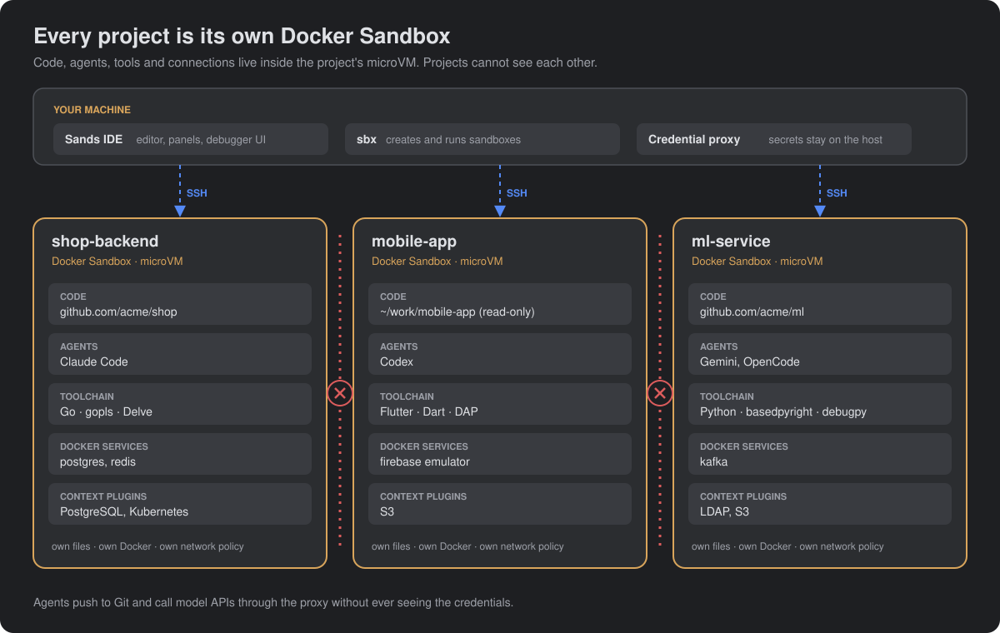
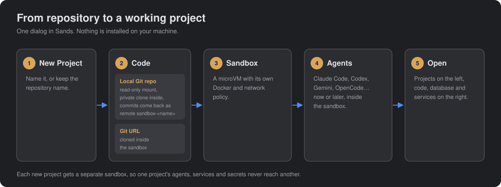

> [!IMPORTANT]
> Remove this line to confirm you've reviewed this PR before submitting.
# Sands

[](https://github.com/rtmo0/ide-sands/actions/workflows/sands_ci.yml)

**An IDE for developing with AI agents, where every project lives in its own [Docker Sandbox](https://docs.docker.com/ai/sandboxes/).**

Coding agents are most useful when they can run builds, tests, containers and tools on their own, and most dangerous
when they do that on your machine with your credentials. Sands gives each project an isolated microVM that holds
everything the project needs: its repositories, its agents, toolchains, debuggers, services and connections to
databases or clusters. Your machine only runs Sands and `sbx`.



## How Sands differs from Zed

Sands is a fork of [Zed](https://github.com/zed-industries/zed) with a different job. Zed is a general-purpose,
collaborative editor with hosted AI services. Sands is a self-contained workbench for AI-driven development in sandboxes.

- **A project is a sandbox.** Create a project from a local Git repository or a Git URL and Sands creates a sandbox for
  it: a local repository is mounted read-only and worked on as a private clone, a remote one is cloned inside. The
  project's files, terminals, language servers and debuggers all run in the sandbox.
- **Agents per project, inside the sandbox.** Attach Claude Code, Codex, Gemini, OpenCode and other agents when you
  create a project or later. They are installed and run only inside its sandbox, never on the host.
- **Secrets stay on the host.** Docker Sandboxes inject API keys and tokens through a proxy, so agents can push to Git or
  call model APIs without seeing the credentials. Network access is governed by sandbox policy.
- **Context as plugins.** Databases, Kubernetes, S3, LDAP and other systems are connected to a project as plugins that
  bring their tools, settings and network rules into the sandbox, an MCP server for the agents and a panel in the IDE.
- **Batteries included.** No extension marketplace, no accounts, no telemetry and no hosted services. Languages,
  debuggers and themes ship with Sands. What is not in the box is not needed.
- **One settings folder.** A project's settings, tasks, debug configurations, MCP servers, agent roles, skills and
  instructions live in `.sands/`. Sands offers to move existing `.vscode/`, `.zed/`, `.claude/` and `.agents/`
  settings there, converting VS Code's `tasks.json` and `launch.json`.
- **Familiar from VS Code.** A JetBrains New UI look and VS Code's fonts.



## Supported languages

Sands supports these languages, with language servers and debugging running inside the sandbox, and no others:

| Language | Language server | Debugger |
|---|---|---|
| Python | basedpyright, ruff | debugpy |
| C# | Roslyn | netcoredbg |
| Rust | rust-analyzer | GDB |
| C / C++ | clangd | GDB |
| Go | gopls | Delve |
| TypeScript / JavaScript | vtsls, ESLint | js-debug |
| Node.js | vtsls, ESLint | js-debug |
| Vue | Vue language server | js-debug, browser DevTools |
| Angular | Angular language service | js-debug, browser DevTools |
| Flutter / Dart | Dart analysis server | Dart debug adapter |

Files every project needs are supported as well: HTML and CSS for Vue and Angular, JSON, YAML, TOML, Markdown, shell
scripts, Dockerfile and Git files.

C#, Vue, Angular and Dart are being moved from Zed extensions into Sands itself. Rust and C++ debug with GDB because
CodeLLDB does not work inside sandboxes yet (`lldb-server` crashes in the microVM).

## Status

Sands is in early development. Working today: the Projects panel, creating projects from a local repository or a Git
URL, opening sandboxes as remote projects, the Sands themes. The full plan, including what was verified on real
sandboxes and what changed the plan, is in [SANDS_TODO.md](./SANDS_TODO.md).

## Building

Requirements on macOS:

- Xcode with the Metal Toolchain (`xcodebuild -downloadComponent MetalToolchain`)
- [rustup](https://rustup.rs) (the toolchain version is pinned in `rust-toolchain.toml`)
- `zig` and `cargo-zigbuild`, used by development builds to cross-compile the remote server that runs in sandboxes
- [Docker Sandboxes](https://docs.docker.com/ai/sandboxes/) (`sbx`) 0.50 or 0.51, signed in with `sbx login`

```sh
cargo run            # development build
script/bundle-mac -d # Sands Dev.app
```

Zed's platform build guides still apply for details:
[macOS](./docs/src/development/macos.md), [Linux](./docs/src/development/linux.md),
[Windows](./docs/src/development/windows.md).

## Licensing

Sands, like Zed, is licensed primarily under GPL-3.0-or-later, with Apache-2.0 components where marked (such as GPUI).
The bundled Sands themes are based on [JetBrains Themes](https://github.com/artemevsevev/zed-theme-jetbrains)
by Artem Evsevev (Apache-2.0), see `assets/themes/LICENSES`. The bundled
[JetBrains New UI icons](https://github.com/ankddev/zed-jetbrains-newui-icons) are MIT-licensed, see
`assets/icons/LICENSES`.

License information for third party dependencies must be correctly provided for CI to pass.

We use [`cargo-about`](https://github.com/EmbarkStudios/cargo-about) to automatically comply with open source licenses. If CI is failing, check the following:

- Is it showing a `no license specified` error for a crate you've created? If so, add `publish = false` under `[package]` in your crate's Cargo.toml.
- Is the error `failed to satisfy license requirements` for a dependency? If so, first determine what license the project has and whether this system is sufficient to comply with this license's requirements. If you're unsure, ask a lawyer. Once you've verified that this system is acceptable add the license's SPDX identifier to the `accepted` array in `script/licenses/zed-licenses.toml`.
- Is `cargo-about` unable to find the license for a dependency? If so, add a clarification field at the end of `script/licenses/zed-licenses.toml`, as specified in the [cargo-about book](https://embarkstudios.github.io/cargo-about/cli/generate/config.html#crate-configuration).
